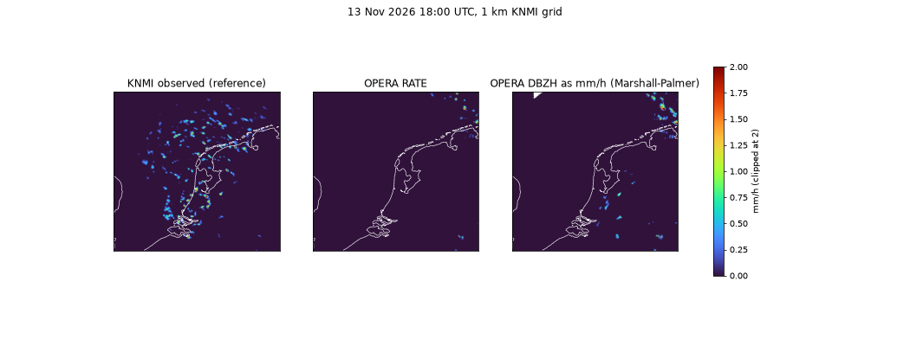

Written by AI on 2026.11.14 by model claude sonnet 5.5.

# Does OPERA see the same rain as KNMI?

## Answer

No, not in the Netherlands and Belgium on the rain we had. Over the last 24 hours KNMI's observed radar showed light showers, mostly under 1 mm/h. OPERA's rain-rate product (RATE) agreed with KNMI on 0.3% of the wet cells, and OPERA's reflectivity product (DBZH, converted to mm/h) on 5%. Both are far too low to forecast from in this area. The test covers light rain only (peak 6.6 mm/h), so it says nothing about heavy rain. OPERA is not usable for the Netherlands on this evidence, and it does not tell us how good OPERA is in countries where KNMI is not the reference.

A fair reading is that the OPERA composites are filtered much harder than KNMI's picture over the Netherlands and Belgium, so light showers there never reach them. I did not find the cause. I ruled out timing, the size of the rain areas and missing data.

## What I compared

- **Reference.** KNMI `nl_rdr_data_rtcor_5m` 1.0: observed 5-minute radar rainfall, gauge-adjusted. The file's value times 0.01 times 12 gives mm/h.
- **OPERA files.** The backup store's RATE (2 km, 15 minutes) and DBZH (1 km, 5 minutes). OPERA describes DBZH as the maximum of all radar cell values at each pixel, not rain at the ground ([ORD overview](https://eumetnet.github.io/openradardata-documentation/1-ORD-API-overview/)).
- **DBZH to rain rate.** Marshall-Palmer, Z = 200 R^1.6, so R = (10^(dBZ/10) / 200)^(1/1.6). Its 0.1 mm/h equals 7.3 dBZ. "Undetect" counts as 0 mm/h. "Nodata" is dropped from every score: it never counts as dry.
- **Same cells.** Each KNMI 1 km cell is matched to the OPERA cell that contains its centre. I checked the grid on one frame (13 Nov 18:00): the strong cells line up by eye (picture below), a search for a shift of up to 200 km found nothing better than no shift, and the DBZH files 10 or 20 minutes either side share far fewer wet cells with KNMI.
- **Times.** KNMI's last 24 hours at 15-minute steps (13 Nov 17:45 to 14 Nov 17:45 UTC). 71 of 97 frames had any wet cell, but the wettest frame had only 2.2% of KNMI's cells wet. I scored the 48 frames with at least 0.2% wet cells (13 Nov 17:45 to 14 Nov 06:45) plus four dry frames (14 Nov 11:30, 13:30, 15:30, 17:30) for false alarms. Rain was light all day: of 94,887 wet cell-times within 100 km of a radar, 84% were 0.1 to 0.5 mm/h, 4,420 were 1 mm/h or more, 365 were 2 mm/h or more and 5 were 5 mm/h or more.
- **Where.** KNMI's picture is a large circle, and far from its radars it sees little. So the main score uses only cells within 100 km of one of KNMI's seven operational radars (Borkum is listed as not operational): 157,485 cells, 7.56 million cell-times. The whole-picture score is in the table too.
- **CSI** is hits divided by hits, misses and false alarms: the share of wet cells (at least 0.1 mm/h) that both agree on, out of every cell that either calls wet.

## Results

| | OPERA RATE | OPERA DBZH, Marshall-Palmer |
|---|---|---|
| CSI at 0.1 mm/h, within 100 km | 0.003 | 0.047 |
| CSI at 0.1 mm/h, whole KNMI picture | 0.004 | 0.017 |
| CSI at 1 mm/h, within 100 km | 0.000 | 0.003 |
| Wet cells both call wet (hits) | 299 | 4,928 |
| KNMI wet, OPERA dry (misses) | 94,588 | 89,959 |
| OPERA wet, KNMI dry (false alarms) | 2,976 | 9,841 |
| Share of KNMI's wet cells that OPERA also calls wet | 0.3% | 5.2% |
| OPERA wet cells as a share of KNMI wet cells | 3% | 16% |

- **RATE on its own 2 km grid.** KNMI averaged inside each OPERA cell: CSI 0.002 (36 hits, 17,117 misses, 711 false alarms). The 1 km versus 2 km difference is not the reason.
- **Tuning DBZH.** Trying other wet thresholds on DBZH peaks at CSI 0.053, at 0 to 4 dBZ. Re-tuning the conversion does not rescue it.
- **Timing.** Comparing OPERA with KNMI 5 minutes earlier or later does not help: RATE 0.002 / 0.003 / 0.005 and DBZH 0.031 / 0.047 / 0.046 (minus 5, 0, plus 5 minutes).
- **Rain areas.** I counted connected areas of KNMI rain within 100 km (2,859 of them) and asked whether OPERA calls any cell inside wet. DBZH did so for 7%, RATE for 1%. Size hardly matters: of the 430 areas of 64 km² or more, DBZH found 11% and RATE none. So small showers being filtered out does not explain it.
- **Dry frames.** On the four frames with no KNMI rain, OPERA is clean within 100 km: 8 RATE and 54 DBZH wet cells out of 629,940. Over the whole KNMI picture it shows 2,790 and 4,755 wet cells out of about 1.9 million. That is probably real rain outside KNMI's sight (Denmark, northern Germany), not an error.

## Intensity bias

- **RATE** has only 299 shared wet cells; there it reads 4.4 times KNMI. Too few to trust. Over all cells within 100 km, OPERA RATE adds up to 21% of KNMI's rain.
- **DBZH (Marshall-Palmer)** reads 0.98 times KNMI on the 4,928 shared wet cells. By KNMI's own intensity it falls steeply: 1.95 times at 0.1 to 0.5 mm/h, 0.48 at 0.5 to 1, 0.27 at 1 to 2 and 0.12 at 2 to 5 mm/h. Part of this is the way the cells are chosen (grouping by KNMI's value makes the other product look low when it is noisy), so it shows that OPERA is noisy and gives no fixed correction factor.
- **Inside OPERA.** At 18:00 on 13 Nov, where DBZH shows 20 to 25 dBZ, RATE averages 0.14 mm/h while Marshall-Palmer gives 0.84 and KNMI 0.22. RATE is the lowest of the three.
- **Marshall-Palmer on a maximum-reflectivity product** is a convenience conversion, not a rain-rate measurement. Each of the three DBZH files I opened covers a 10-minute window (for example 17:05:01 to 17:15:00 UTC), and the file header says some inputs are advected from earlier scans by Météo-France.

## What is systematic

- **Netherlands and Belgium are close to blank in RATE.** Across the 48 rainy frames, OPERA RATE calls only 5 cell-times wet in the whole area nearest Den Helder, Herwijnen, Jabbeke, Helchteren and Wideumont, and none of those 5 coincide with KNMI rain. Hits come only from the German side (Essen 258, Neuheilenbach 41). OPERA lists those Dutch and Belgian radars in every file (`nldhl`, `nlhrw`, `behel`, `bejab`, `bewid`), and on the one frame I checked (13 Nov 18:00) the RATE quality index there is about 0.9 or higher, so OPERA is confident there is no rain, not unsure. The node list says which radars went into the composite; it does not prove each one delivered rain echoes.
- **DBZH sees some of it, unevenly.** Within 100 km, by nearest KNMI radar: Wideumont CSI 0.27, Herwijnen 0.15, Helchteren 0.14, Essen 0.09, Neuheilenbach 0.05, Den Helder 0.001, Jabbeke 0.000.
- **Sea and coast.** Most KNMI rain on the day was offshore in a north-westerly shower flow. Of KNMI's wet cells, DBZH matched none of 42,452 at sea more than 10 km from land, 41 of 18,964 at sea within 10 km of land, 462 of 17,185 on land within 10 km of water (2.7%), and 4,425 of 16,286 further inland (27%, CSI 0.17). RATE matched none of the sea or coast cells. Land and sea come from the `global-land-mask` package at about 1 km, which is crude, and the IJsselmeer may count as sea.
- **Germany and the edge.** Near Essen and Neuheilenbach, DBZH calls 11 and 20 times as many cells wet as KNMI. KNMI is the reference, so I cannot say which is right. Outside 100 km of KNMI's radars OPERA sees rain that KNMI cannot, so there is nothing to score against.
- **Missing radars and nodata.** No KNMI-area radar dropped out of any of the 52 frames' node lists. Over the frames I scored, 5 Danish radars were absent from 3 or 4 files each. Nodata cells are rare in KNMI's area. Over the whole KNMI picture they cover 0.05 to 0.12% of cells in RATE and 2.6% in DBZH, rising to 4.4 to 5.6% in DBZH from 22:45 to 23:45 UTC on 13 Nov. None are within 100 km of the radars. One day is too little to say anything firmer about outages.
- **Not obviously a grid error.** The same code matches 27% of KNMI's wet cells inland with DBZH, the strong cells line up by eye, and the shift search found no better offset. I cannot rule out a small mapping error with certainty, but it would not explain RATE finding nothing.

## Files missing or late (backup store, listing only)

The store lists object write times, so "delay" here means data time to upload. Late means DBZH more than 7 minutes (nominal about 4) or RATE more than 12 minutes (nominal 10).

| | Expected | Present | Missing | Late | Median / max delay |
|---|---|---|---|---|---|
| DBZH, 14 Nov 00:00 to 17:35 UTC | 212 | 210 | 2 (02:40, 14:55) | 1 (7.15 min) | 4.2 / 7.2 min |
| RATE, 14 Nov 00:00 to 17:30 UTC | 70 | 70 | 0 | 0 | 10.05 / 10.08 min |
| DBZH, 13 Nov, whole day | 288 | 288 | 0 | 1 (7.05 min) | 4.2 / 7.1 min |
| RATE, 13 Nov, whole day | 96 | 96 | 0 | 0 | 10.05 / 10.1 min |

Both missing 14 Nov files give a 404. No file was unusually small. At 17:47 UTC the store still listed files back to 13 Nov 00:00, so today it keeps more than 24 hours, but do not count on that.

## Who hosts OPERA

I read each page below on 14 Nov 2026. For some I only saw the passages my search returned, and I say so.

| Who | What they do | Evidence |
|---|---|---|
| **EUMETNET** (OPERA programme, led by the Finnish Met Institute) | Produces the OPERA composites and publishes them under CC BY 4.0. Runs MeteoGate, the public front door. | [OPERA programme page](https://www.eumetnet.eu/observations/weather-radar-network); [MeteoGate overview](https://eumetnet.github.io/meteogate-documentation/1-overview) |
| **Open Radar Data (ORD) API** | The API and message service over the OPERA data. Built in the RODEO project, operational since 20 May 2026. Anonymous use 60 requests an hour, registered 600 (the gateway also answered with an `X-RateLimit-Limit` of 200; I did not find what window that covers). | [ORD documentation](https://eumetnet.github.io/openradardata-documentation/), [ORD overview](https://eumetnet.github.io/openradardata-documentation/1-ORD-API-overview/), [20 May 2026 newsletter](https://raw.githubusercontent.com/EUMETNET/openradardata-documentation/main/docs/attachments/ORD_API_newsletter_20052026_vs2.pdf) |
| **RODEO** | EU-funded project (Digital Europe Programme plus EUMETNET members) that built ORD and MeteoGate. It ended at the end of 2025. EUMETNET says the results moved into its operational activities. | [EUMETNET RODEO page](https://www.eumetnet.eu/external-projects/rodeo-2/) |
| **European Weather Cloud (EWC)** | A cloud run jointly by ECMWF and EUMETSAT, operational since 26 September 2023, aimed at national met services and researchers. The ORD API and ingest software run on it, and so does the MeteoGate API gateway. | [ECMWF newsletter 180](https://www.ecmwf.int/en/newsletter/180/computing/european-weather-cloud-now-operational), [EWC home](https://www.europeanweather.cloud/), [ORD overview](https://eumetnet.github.io/openradardata-documentation/1-ORD-API-overview/), [MeteoGate overview](https://eumetnet.github.io/meteogate-documentation/1-overview) |
| **CloudFerro** | A commercial cloud company focused on Earth observation. Its Warsaw region WAW3-1 hosts the S3 bucket `openradar-24h`, which the ORD docs name as the 24-hour cache. | [CloudFerro public clouds](https://cloudferro.com/cloud/our-public-clouds), [ORD overview](https://eumetnet.github.io/openradardata-documentation/1-ORD-API-overview/) |
| **ECMWF backup bucket** | The bucket we actually download from today. | [ORD overview, "ORD Backup" notice](https://eumetnet.github.io/openradardata-documentation/1-ORD-API-overview/) |

What I found on stability, in order from the data to the bucket:

- **EUMETNET and OPERA production: most stable.** The OPERA programme manager's slides (May 2026) say CIRRUS (DBZH) and NIMBUS (RATE) meet their service level, with average timeliness 4.6 and 8.8 minutes. NIMBUS availability in 2025 was 99.0 to 99.7% after some significant disruptions. Data availability from the radars is 95%, and the programme lists about 170 radars in the composite ([slides](https://gebrada.upc.es/resources/docs/inline/2.1-vonlerber.pdf)). My own listing agrees: DBZH 4.2 minutes late, RATE 10.05. I found no public financial commitment beyond RODEO's end.
- **ORD API and MeteoGate: young, no published promise to users.** Operational for under six months, about 100 users or entities at the start of June ([slides](https://gebrada.upc.es/resources/docs/inline/2.1-vonlerber.pdf)). MeteoGate says it targets a quality of service that is higher for operational data than for non-operational, but I found no numbers a user can hold it to ([MeteoGate publishing guide](https://eumetnet.github.io/meteogate-documentation/3-publishing-data)). Disruptions are announced through an OPERA mailing list ([newsletter](https://raw.githubusercontent.com/EUMETNET/openradardata-documentation/main/docs/attachments/ORD_API_newsletter_20052026_vs2.pdf)). Its API metadata answered today (HTTP 200, 24-hour extent to 17:57 UTC), and so did the backup API at `radar-backup.meteogate.eu/api`.
- **European Weather Cloud: well run, but not a service for us.** The EWC is built "for national meteorological and hydrological services" and researchers ([EWC home](https://www.europeanweather.cloud/)). The radar service rides on it as a RODEO component. We would not have a relationship with it.
- **CloudFerro primary bucket: broken now.** The ORD overview says OPERA's primary 24-hour cache is `s3.waw3-1.cloudferro.com/openradar-24h`. I listed the bucket: it holds two stray objects (a German radar scan from 9 Oct and a Polish radar volume from 27 Oct) and no composites. The page's notice about "an issue with our cloud provider" was added to the documentation in the commit titled "Backup" on 12 Nov 2026 09:03 UTC ([documentation history](https://github.com/EUMETNET/openradardata-documentation/commits/main/docs/1-ORD-API-overview.md)). It gives no cause and no end date. I cannot tell from here when composites stopped landing in the primary bucket.
- **ECMWF backup bucket: temporary by its own description.** The notice says services were "temporarily moved" to the backup domain until the issue is resolved. The hostname (`cci1`) matches ECMWF's Common Cloud Infrastructure, which is my inference ([ECMWF CCI page](https://www.ecmwf.int/en/computing/our-facilities/common-cloud-infrastructure)). Everything we measured today came from here.

We would rely on EUMETNET's OPERA data, reached through its documented front door (the ORD API, or its message service), not on any one bucket. Today the files are only in a bucket its owner calls temporary. The ingest in our server should read the source from configuration and try the documented locations in turn.

## What this means for the plan

- **Netherlands.** Keep KNMI. OPERA cannot replace it, and RATE is nearly blank there.
- **Rest of Europe.** This check does not show OPERA is good or bad outside KNMI's area. It does show OPERA misses light showers in at least NL and BE, and that RATE reads low even next to DBZH. Both are worth knowing before we promise "rain in 10 minutes" in other countries.
- **Missing evidence.** One light-rain day is a poor test. The store keeps one or two days, so a heavier event has to be collected as it happens, and a second reference for a country other than the Netherlands is needed to judge OPERA there. I have not done either.

## Reproduce

`research/verification/opera_check.py` does the scan, the comparison, the figure and the store audit; its header gives the commands. Needs numpy, h5py, pyproj, scipy and global-land-mask (matplotlib for the figure), the KNMI key in `KNMI_API_KEY`, and the OPERA backup store is anonymous. `research/verification/opera_check_result.json` keeps the pooled numbers behind this page. Downloaded files were deleted; the store only keeps recent files, so a rerun later scores a different day.
